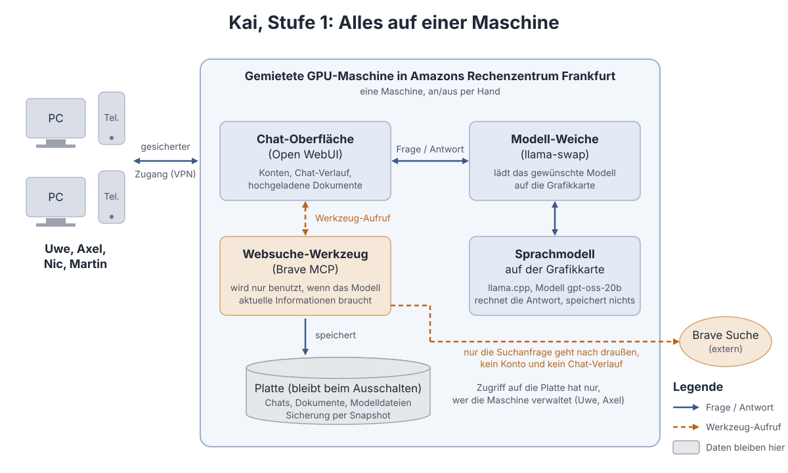

# Kai — unsere private KI

Kai ist ein gemeinsamer KI-Chat für vier Freunde. Das Sprachmodell läuft auf einer **gemieteten Grafikkarten-Maschine in Frankfurt**, die wir selbst kontrollieren: niemand außer uns liest die Gespräche mit, und die Maschine wird nur eingeschaltet, wenn wir sie brauchen.

## So funktioniert es, in drei Sätzen

1. Du öffnest im Browser (PC oder Telefon) die **Chat-Oberfläche** und meldest dich mit deinem Konto an.
2. Deine Frage geht an das **Sprachmodell**, das auf der Grafikkarte der Maschine rechnet. Es antwortet und merkt sich nichts; dein Chat-Verlauf liegt in deinem Konto.
3. Wenn es sinnvoll ist, benutzt das Modell ein **Werkzeug**, zunächst die Websuche von Brave, um aktuelle Informationen zu holen.

## Was wo steht

| Für wen | Dokument |
|---|---|
| Alle | Dieses Blatt und die Bilder in [docs/bilder/](docs/bilder/) |
| Technisch Interessierte | [Architektur und Entscheidungen](docs/01_architektur.md) |
| Uwe (Infrastruktur) | [Anforderungen an Maschine, Platte, Netz, Zugang](docs/02_anforderungen-infrastruktur.md) |
| Modellwahl | [Modellvorschlag für die T4-Grafikkarte](docs/03_modellvorschlag.md) |
| Vorgehen | [Plan: Phasen, Aufgaben, Prüfungen](docs/04_plan.md) |
| Admins | [compose/.env.example](compose/.env.example): welche Zugangsdaten gebraucht werden |

## Bausteine (Stufe 1)

| Baustein | Was er tut | Software |
|---|---|---|
| Chat-Oberfläche | Konten, Gespräche, Dokumente, Werkzeuge | [Open WebUI](https://github.com/open-webui/open-webui) |
| Modell-Weiche | Lädt das gewählte Modell auf die Grafikkarte, tauscht bei Bedarf | [llama-swap](https://github.com/mostlygeek/llama-swap) |
| Modellserver | Rechnet die Antworten | [llama.cpp](https://github.com/ggml-org/llama.cpp) |
| Erstes Modell | Allrounder, 21 Mrd. Parameter, passt in 16 GB | [gpt-oss-20b](https://huggingface.co/ggml-org/gpt-oss-20b-GGUF) |
| Websuche | Sucht im Internet, wenn das Modell es anfordert | [Brave Search MCP](https://github.com/brave/brave-search-mcp-server) |

Alles läuft in Docker-Containern und wird mit Ansible aus diesem Repository eingerichtet ([ansible/](../ansible/)).

## Später (Stufe 2)

Oberfläche und Rechenknoten werden getrennt: eine kleine, dauerhaft laufende Maschine hält Konten und Verlauf, Grafikkarten-Maschinen werden nur bei Bedarf dazugeschaltet. Siehe [Architektur §4](docs/01_architektur.md#4-ausblick-stufe-2-oberfläche-und-rechenknoten-trennen).

## Stand

Phase 1 (Design) in Abstimmung · Phase 2 (Skripte) und Phase 3 (Umsetzung) folgen · Aufgaben in ClickUp, Sprint 01.
